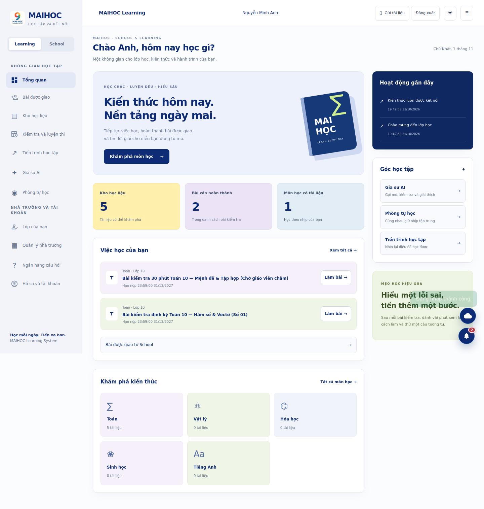
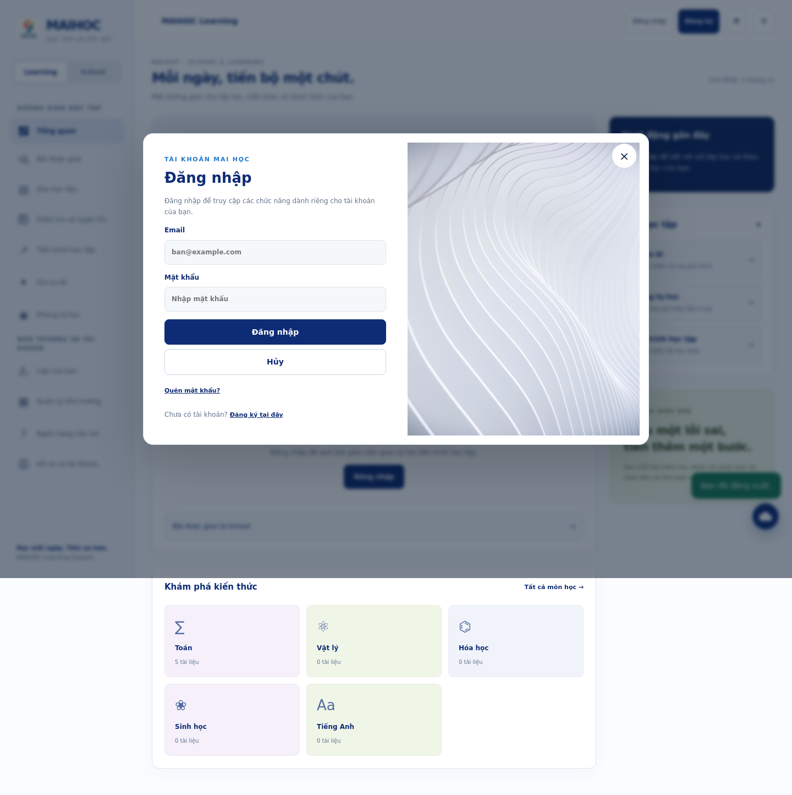
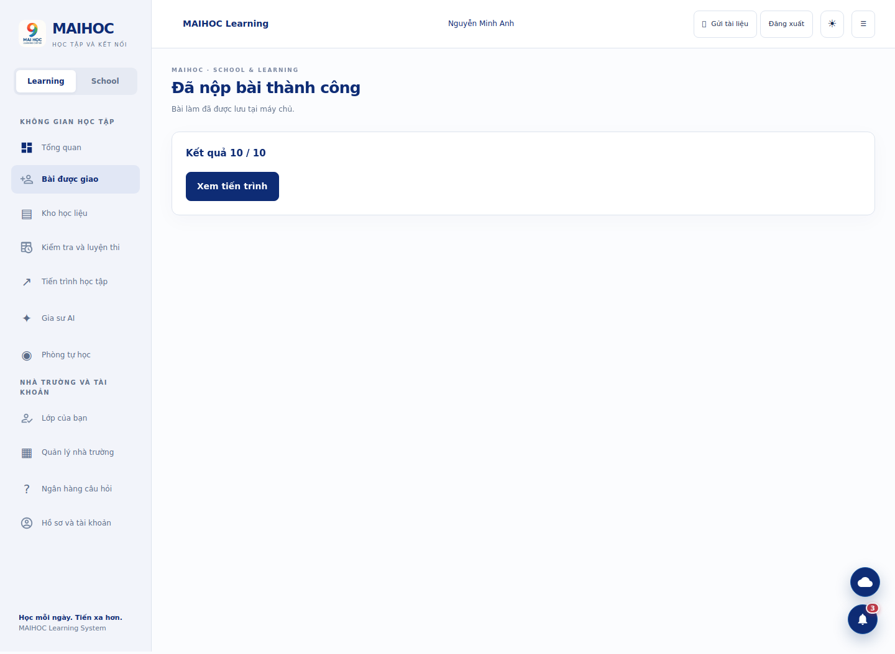
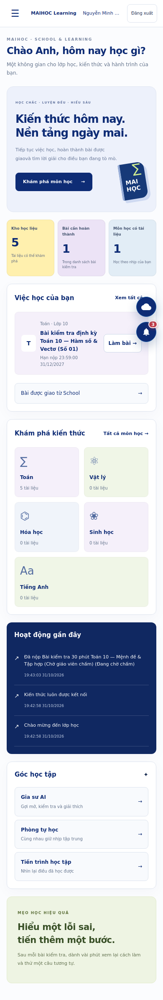

# Thiết kế giao diện MAIHOC

Tham chiếu: [SecureCourse Community](https://www.figma.com/design/VSooXgFC7vmfsO7xardcMe/Secure-Course--Community-?node-id=9-2). Đã đọc thiết kế desktop dashboard và login bằng Figma design context; các screenshot người dùng cung cấp là định hướng responsive.

Giữ sidebar nền sáng, navy `#0e2c75`, thẻ pastel, bố cục nội dung/hoạt động bên phải và hình trang trí ở cột phải form xác thực. Điều chỉnh nội dung, logo, kích thước chữ và navigation cho trường THPT. Không dùng logo SecureCourse, ảnh đại diện mẫu hoặc quy trình điểm danh sinh trắc học. Logo MAIHOC và danh tính lấy từ dự án.

| Asset | Nguồn node/slot | Cách dùng |
| --- | --- | --- |
| `public/design/login-art.png` | Login Desktop `46:359`, Login Art `49:581` | Cột phải auth desktop, banner đầu auth mobile |
| `dashboard.svg` | Sidebar dashboard icon | Tổng quan |
| `profile.svg` | Sidebar profile icon | Hồ sơ |
| `registration.svg` | Sidebar registration icon | Bài được giao |
| `calendar.svg` | Sidebar timetable icon | Kiểm tra/luyện thi |
| `school.svg` | Sidebar attendance icon | Lớp của bạn |

Các asset đã được tải cục bộ; không có URL asset Figma tạm thời trong runtime. Hình quyển sách trên dashboard là trang trí CSS riêng của MAIHOC.

Các trạng thái: đang tải, chưa có dữ liệu, chưa đăng nhập, nền tảng chưa bật, lỗi API, đã lưu local, đã đồng bộ server, chờ chấm và đã chấm. Không dùng tỷ lệ chuyên cần hoặc điểm số giả để lấp dashboard.

Điều hướng dùng button có tên rõ, focus ring, skip link; menu mobile có aria-expanded và inert khi đóng; form có label; trạng thái dùng aria-live. Đây là các cải tiến accessibility đã triển khai, không phải chứng nhận WCAG toàn sản phẩm.

## Ảnh đã kiểm tra trên ứng dụng

Ảnh dưới đây dùng tài khoản và dữ liệu kiểm thử cô lập, không phải dữ liệu học sinh production.

